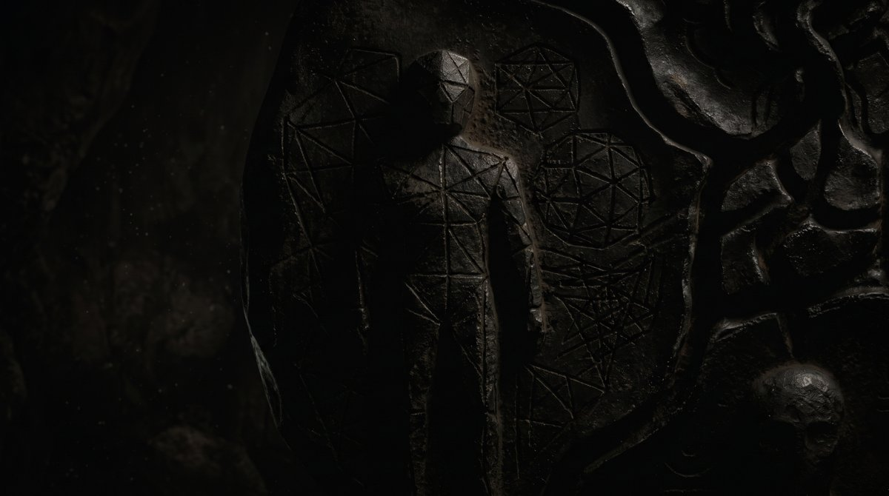
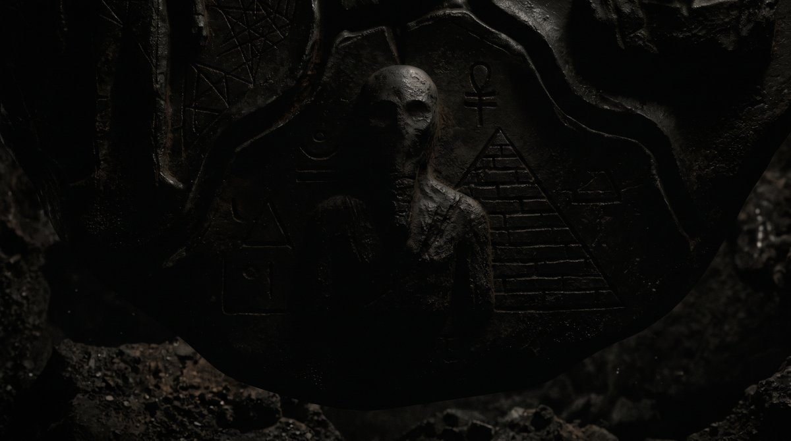

<div align="center">
  <h1>Demiurge</h1>
  <p><i>"The world is a fabrication of an error."</i><br>— The Gospel of Philip (Nag Hammadi)</p>
  <p><b>A Pantheon of three autonomous agents in an empirical feedback loop. One researches; one designs; one builds.</b></p>
</div>

<div align="center">
  
</div>

Demiurge isolates empirical research from agent synthesis. Self-contained, dependency-free, and anchored on deterministic quality gates.

<table>
  <tr>
    <td width="200"></td>
    <td><b>Demiurge</b><br>The system around the agents: deterministic gates, releases, a run ledger and benchmarks that make every agent prove its work.</td>
  </tr>
  <tr>
    <td width="200"></td>
    <td><b>Niccolo</b><br>Researches agentic engineering and proposes graded updates to the knowledge base, accepting no claim without 3 verified, hyperlinked sources.</td>
  </tr>
  <tr>
    <td width="200"></td>
    <td><b>Marcus</b><br>Designs, audits and proves agent skills through gates G0 to G6, and refuses to ship any skill without measured evidence.</td>
  </tr>
  <tr>
    <td width="200"></td>
    <td><b>Imhotep</b><br>Builds your real deliverables at the ambitious level with Marcus's measured skills, scored by held-out checks it never reads.</td>
  </tr>
</table>

Commands, prompts and integrations for each persona: [Personas](docs/PERSONAS.md).

## Quick start

1. Install the skills into your harness: [Installation Guide](docs/INSTALLATION.md).
2. Pick a workflow and prompt template: [Operating Guide](docs/OPERATING_GUIDE.md).

## How it works

```
Niccolo     ──proposes diff──> Operator Sign-Off ──merges──> research/RESEARCH.md
                                                                      │
                                                                   read by
                                                                      │
Agent Packages <──emits & proves── Marcus ──checks gates (G0-G6) <────┘
      │
   equips
      ▼
   Imhotep ──builds real work──> held-out judge ──outcomes──> run ledger ──> Niccolo & Marcus
```

Research flows one way: Niccolo researches, Marcus designs, Imhotep builds. A human approves every knowledge base update. Full design: [Master Documentation](docs/DOCUMENTATION.md).

## Documentation

| Guide | Scope |
|---|---|
| [Installation Guide](docs/INSTALLATION.md) | Deployment across harnesses and optional research connectors. |
| [Personas](docs/PERSONAS.md) | What each persona does, with slash commands, prompts, and integrations. |
| [Operating Guide](docs/OPERATING_GUIDE.md) | Workflows, prompt templates, and best practices. |
| [Master Documentation](docs/DOCUMENTATION.md) | Full system design and specification. |
| [Benchmarks](docs/BENCHMARKS.md) | Evaluation method and the Benchmark Run Registry. |
| [Evidence & Confidence Taxonomy](docs/EVIDENCE.md) | How claims are verified and graded. |

All guides: [docs/README.md](docs/README.md). Release history: [CHANGELOG.md](CHANGELOG.md). Agent rules: [Standing Orders](docs/STANDING_ORDERS.md).
