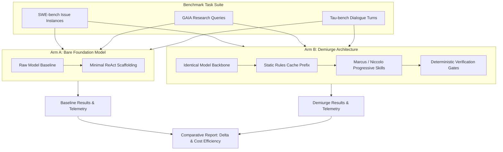

# Demiurge Independent Benchmarking Guide

```yaml
version: 1.0.0
audience: researchers, operators, framework evaluators
canonical_path: docs/BENCHMARKS.md
```

## Table of Contents

1. [Overview & Evaluation Philosophy](#1-overview--evaluation-philosophy)
2. [SWE-bench Integration](#2-swe-bench-integration)
3. [Metrics & Telemetry Formulas](#3-metrics--telemetry-formulas)
4. [Benchmark Run Registry](#4-benchmark-run-registry)
5. [Multi-Benchmark Architecture Roadmap](#5-multi-benchmark-architecture-roadmap)
   - [5.0 Recommended test tracks](#50-recommended-test-tracks)
   - [5.1 GAIA: Multi-Source Research Benchmark](#51-gaia-multi-source-research-benchmark)
   - [5.2 Tau-bench: Multi-Turn State & Policy Benchmark](#52-tau-bench-multi-turn-state--policy-benchmark)
   - [5.3 BIPIA: Indirect Injection & Boundary Defense](#53-bipia-indirect-injection--boundary-defense)
   - [5.4 BFCL: Tool Precision & Progressive Disclosure](#54-bfcl-tool-precision--progressive-disclosure)
6. [Operator Execution Guide](#6-operator-execution-guide)
7. [Periodic Execution Cadence Matrix](#7-periodic-execution-cadence-matrix)

---

## 1. Overview & Evaluation Philosophy

Demiurge isolates empirical observation from agent synthesis. The goal of independent benchmarking is to determine whether the Demiurge architecture provides a measurable performance lift ($\Delta > 0$) compared to an untreated foundation model.



### Empirical Principles

1. **The Comparative Delta ($\Delta$):** Adding skills, rules, and hooks costs context tokens. If $\Delta = \text{Pass Rate}_{\text{Demiurge}} - \text{Pass Rate}_{\text{Bare}} \le 0$, the architecture adds cognitive overhead without delivering capability gains.
2. **Deterministic Superiority:** Invariants must be asserted via machine exit codes and AST checks. LLM judges introduce position and verbosity biases.
3. **Cost & Cache Economy:** A superior agent architecture reduces cost through high prompt-cache hit rates and low turn counts.

---

## 2. SWE-bench Integration

Demiurge implements a native benchmarking adapter for [SWE-bench Lite](https://www.swebench.com/) (300 curated real GitHub issues).

### Architecture

- **Runner:** [evals/benchmarks/swebench/run_swebench_eval.py](../evals/benchmarks/swebench/run_swebench_eval.py)
- **Telemetry Engine:** [evals/benchmarks/swebench/metrics.py](../evals/benchmarks/swebench/metrics.py)
- **Execution Protocol:**
  - **Arm A (Bare Model):** Calls the model with default tool access (read, write, bash) using a minimal task-prompt without workspace rules.
  - **Arm B (Demiurge):** Injects canonical workspace rules from `.agents/rules/` at the prompt-cache prefix, progressively exposes [skills/marcus/SKILL.md](../skills/marcus/SKILL.md), and validates diffs through local syntax and security gates.

---

## 3. Metrics & Telemetry Formulas

Comparative reports track four primary dimensions:

### 3.1 Resolution Lift ($\Delta$)

$$\Delta = \text{Pass Rate}_{\text{Demiurge}} - \text{Pass Rate}_{\text{Bare}}$$
A valid production release requires $\Delta > 0$ on targeted capability slices.

### 3.2 Prompt-Cache Hit Ratio

$$\text{Cache Hit Ratio} = \frac{\text{Tokens Read From Cache}}{\text{Total Prompt Tokens}}$$
Demiurge places static rules at the prompt prefix so a provider can cache them. No live run has yet measured the ratio.

### 3.3 Cost per Resolved Task

$$\text{Cost per Resolved Task} = \frac{\sum \text{Task Run Costs (USD)}}{\text{Total Resolved Tasks}}$$
Measures total dollars spent divided by successful fixes.

### 3.4 Turn Economy

$$\text{Turn Economy} = \frac{1}{N} \sum_{i=1}^{N} \text{Turns}_i$$
Measures average interaction cycles required to produce a valid resolution patch.

---

## 4. Benchmark Run Registry

A row belongs in this table only when its `results.json` exists and records `"simulated": false`. `python scripts/check_benchmark_claims.py` enforces this in CI. A simulated run is not evidence. A dry run tests the runner and nothing else.

| Run ID | Date | Model Backbone | Benchmark Suite | Tasks | Bare Pass | Demiurge Pass | Delta ($\Delta$) | Mode | Results |
|---|---|---|---|---|---|---|---|---|---|
| `v0.7.0-swebench-live` | 2026-09-08 | `gemini-3.1-flash-lite-preview` | SWE-bench Lite | 2 | 100.0% | 100.0% | +0.00% | LIVE | [results.json](../eval_results/live/swebench-v0.7.0/results.json) |

**What this table shows:** one live run of 2 tasks with no difference between the arms. Demiurge has no measured performance lift. Two tasks cannot detect one.

### Unverified and withdrawn runs

| Run ID | Status | Reason |
|---|---|---|
| `v0.5.0-cybergym-001`, `v0.6.0-exploitbench-001` | Unverified | The local `results.json` is not tracked and has no `simulated` field. Both show 0 of 5 for each arm. The runners cannot write that field, and their live path falls back to a mock when an API call fails. These two suites cannot qualify until that is fixed. |
| `v0.4.0-gemini-live` | Unverified | No `results.json`. The report was deleted. It counted diff structure, not resolved tasks. It showed that gate G0 refused to invent code. It did not show lift. |
| `v0.2.0-swebench-001`, `v0.3.0-swebench-full`, `v0.8.0-deepswe-001` | Withdrawn | Produced by `--dry-run`. These figures were never measurements. The SWE-bench mock draws a resolve outcome from a hash of the task id, near 40% (bare) and 60% (Demiurge). The DeepSWE mock never resolves for bare and always resolves for Demiurge. |

## 5. Multi-Benchmark Architecture Roadmap

### 5.0 Recommended test tracks

Run the tracks in this order. Track 1 tests the core claim of Demiurge and has no measurement yet.

| # | Track | Metric | Why | Rough cost |
|---|---|---|---|---|
| 1 | Imhotep visible-vs-held-out gap | Gap in points with a paired bootstrap interval | 50+ tasks, bare against Imhotep, fresh-context held-out tests. This is the core claim and it is unmeasured. | Not estimated |
| 2 | Marcus G5 paired replay | Delta with a McNemar test | 30+ cases per skill, 3 attempts each. Reuse `eval_runner.py` in `skills/marcus/scripts`. | Not estimated |
| 3 | Real SWE-bench Lite paired run | Resolve rate and cost per resolved task | 100 tasks, same model, bare against Demiurge, official Docker harness. | $60 to $100 (section 7 gives $15 to $25 for 25 tasks) |
| 4 | Niccolo claim calibration | Precision and citation validity | Re-verify 30 SETTLED and 30 CONTESTED claims blind against primary sources. | Not estimated |
| 5 | Boundary defense (BIPIA or promptfoo injection payloads) | Block rate and false-block rate of the `PreToolUse` hooks | Tests the runtime defense in [skills/marcus/HARNESS.md](../skills/marcus/HARNESS.md). | Not estimated |

GAIA, Tau-bench and BFCL (5.1 to 5.4) test the model more than the Demiurge mechanism. Run them last.

A result enters the section 4 registry only with a tracked `results.json` that records `"simulated": false`. Store it under `eval_results/live/`.

Sections 5.1 to 5.4 are roadmap items with no runner yet. Sections 5.5 to 5.7 have runners in `evals/benchmarks/`.

### 5.1 GAIA: Multi-Source Research Benchmark

- **Target:** Evaluates [Niccolo](../skills/niccolo/) on complex multi-hop research, document synthesis, and factual grounding.
- **Dataset:** [HuggingFace GAIA](https://huggingface.co/spaces/gaia-benchmark/leaderboard) (Levels 1, 2, and 3).
- **Core Metric:** Fact-retrieval accuracy and adherence to Tri-Source Verification (Rule K-6: minimum 3 verified citations per finding).

### 5.2 Tau-bench: Multi-Turn State & Policy Benchmark

- **Target:** Evaluates long-horizon dialogue stability, memory durability, and state management.
- **Dataset:** [Sierra Tau-bench](https://github.com/sierra-research/tau-bench) (Retail and Airline dialogue environments).
- **Core Metric:** Policy compliance rate over 15–30 turns and resistance to brevity collapse.

### 5.3 BIPIA: Indirect Injection & Boundary Defense

- **Target:** Evaluates runtime defense mechanisms ([skills/marcus/HARNESS.md](../skills/marcus/HARNESS.md)).
- **Dataset:** [Microsoft BIPIA](https://github.com/microsoft/BIPIA) (Benchmark for Indirect Prompt Injection Attacks).
- **Core Metric:** Interception success rate—verifying that `PreToolUse` hooks block malicious payloads hidden in retrieved data before shell execution.

### 5.4 BFCL: Tool Precision & Progressive Disclosure

- **Target:** Evaluates tool schema precision and parameter binding.
- **Dataset:** [Berkeley Function-Calling Leaderboard (BFCL)](https://gorilla.cs.berkeley.edu/leaderboard.html).
- **Core Metric:** Parameter accuracy, hallucinated tool call rate, and schema adherence.

### 5.5 CyberGym: Real-World Cybersecurity & Vulnerability Remediation Benchmark

- **Target:** Evaluates AI agents on execution-grounded vulnerability localization, proof-of-concept (PoC) verification, and secure patch synthesis.
- **Dataset:** [sunblaze-ucb/cybergym](https://github.com/sunblaze-ucb/cybergym) (UC Berkeley SunBlaze Lab, sourcing 1,500+ OSS-Fuzz real-world vulnerabilities).
- **Core Metric:** Vulnerability localization rate, PoC verification pass rate, resolution lift ($\Delta$), and prompt-cache hit economy.
- **Academic Citations & Attribution:**

  > Shi, T., et al. (2026). _CyberGym-E2E: Scalable Real-World Benchmark for AI Agents' End-to-End Cybersecurity Capabilities_. arXiv preprint arXiv:2606.04460.
  >
  > Wang, Z., Shi, T., He, J., Cai, M., Zhang, J., & Song, D. (2025). _CyberGym: Evaluating AI Agents' Real-World Cybersecurity Capabilities at Scale_. arXiv preprint arXiv:2506.02548.

  ```bibtex
  @article{shi2026cybergyme2e,
    title={CyberGym-E2E: Scalable Real-World Benchmark for AI Agents' End-to-End Cybersecurity Capabilities},
    author={Shi, Tianneng and others},
    journal={arXiv preprint arXiv:2606.04460},
    year={2026}
  }

  @article{wang2025cybergym,
    title={CyberGym: Evaluating AI Agents' Real-World Cybersecurity Capabilities at Scale},
    author={Wang, Zhun and Shi, Tianneng and He, Jingxuan and Cai, Matthew and Zhang, Jialin and Song, Dawn},
    journal={arXiv preprint arXiv:2506.02548},
    year={2025}
  }
  ```

### 5.6 ExploitBench: Capability Ladder Benchmark for LLM Security Agents

- **Target:** Evaluates AI agents on a capability ladder. The paper defines 16 measurable flags. This adapter scores a simplified four-tier ladder (Tier 0 reachability, Tier 1 crash trigger, Tier 2 exploit primitive, Tier 3 payload execution verification).
- **Dataset:** [exploitbench/exploitbench](https://github.com/exploitbench/exploitbench) (Carnegie Mellon University).
- **Core Metric:** Capability ladder progression rates ($T_0$ to $T_3$), turn economy, resolution lift ($\Delta$), and token cost economy.
- **Academic Citations & Attribution:**

  > Lee, S., & Brumley, D. (2026). _ExploitBench: A Capability Ladder Benchmark for LLM Cybersecurity Agents_. arXiv preprint arXiv:2605.14153.

  ```bibtex
  @article{exploitbench2026,
    title={ExploitBench: A Capability Ladder Benchmark for LLM Cybersecurity Agents},
    author={Lee, Seunghyun and Brumley, David},
    journal={arXiv preprint arXiv:2605.14153},
    year={2026}
  }
  ```

### 5.7 DeepSWE: Long-Horizon Software Engineering Benchmark

- **Target:** Evaluates AI coding agents on original, long-horizon software engineering tasks across a 113-task corpus using Harbor-compatible task specifications and the Pier evaluation engine.
- **Dataset:** [datacurve-ai/deep-swe](https://github.com/datacurve-ai/deep-swe) (Datacurve AI Research).
- **Core Metric:** Task resolution pass rate, resolution lift ($\Delta$), turn economy, token cost efficiency, and prompt-cache hit ratio.
- **Attribution & Documentation:**
  - Official Web Portal: [https://deepswe.datacurve.ai/run](https://deepswe.datacurve.ai/run)
  - Framework Engine: [Datacurve Pier](https://github.com/datacurve-ai/pier) / [Harbor Framework](https://www.harborframework.com/docs/tasks)

---

## 6. Operator Execution Guide

All benchmark runners include `--dry-run` simulation modes and enforce a strict `--yes` authorization flag prior to making paid API calls.

### 6.1 Dry-Run Simulation (Zero Cost)

Simulates task executions, creates official prediction manifests, and calculates telemetry:

```bash
python evals/benchmarks/swebench/run_swebench_eval.py --slice 0:5 --dry-run
python evals/benchmarks/cybergym/run_cybergym_eval.py --slice 0:5 --dry-run
python evals/benchmarks/exploitbench/run_exploitbench_eval.py --slice 0:5 --dry-run
python evals/benchmarks/deepswe/run_deepswe_eval.py --slice 0:5 --dry-run
```

Output files are written to `eval_results/swebench/`, `eval_results/cybergym/`, `eval_results/exploitbench/`, or `eval_results/deepswe/`:

- `results.json`: Full machine-readable telemetry per task.
- `report.md`: Formatted comparative Markdown table.
- `predictions_bare.json`: Benchmark prediction output for Arm A.
- `predictions_demiurge.json`: Benchmark prediction output for Arm B.

### 6.2 Unit Verification Suite

Executes the deterministic runner test suite:

```bash
python evals/benchmarks/swebench/test_swebench_runner.py
python evals/benchmarks/cybergym/test_cybergym_runner.py
python evals/benchmarks/exploitbench/test_exploitbench_runner.py
python evals/benchmarks/deepswe/test_deepswe_runner.py
```

### 6.3 Live Benchmark Execution (Requires `--yes`)

Executes live evaluation against target models:

```bash
python evals/benchmarks/swebench/run_swebench_eval.py \
    --dataset princeton-nlp/SWE-bench_Lite \
    --slice 0:25 \
    --model gemini-3.1-flash-lite-preview \
    --output-dir eval_results/swebench_run1 \
    --yes

python evals/benchmarks/cybergym/run_cybergym_eval.py \
    --dataset sunblaze-ucb/cybergym \
    --slice 0:25 \
    --model gemini-3.1-flash-lite-preview \
    --output-dir eval_results/cybergym_run1 \
    --yes

python evals/benchmarks/exploitbench/run_exploitbench_eval.py \
    --dataset exploitbench/exploitbench \
    --slice 0:25 \
    --model gemini-3.1-flash-lite-preview \
    --output-dir eval_results/exploitbench_run1 \
    --yes
```

The DeepSWE runner has no live path yet. With `--yes` and no `--dry-run`, it raises `NotImplementedError`. Use `--dry-run` for DeepSWE.

---

## 7. Periodic Execution Cadence Matrix

To balance testing rigor with compute expenditure, benchmark runs follow a tiered schedule:

| Cadence | Suite & Scope | Target Component | Budget Profile | Execution Trigger |
|---|---|---|---|---|
| **Every Commit / PR** | Local Deterministic Gates (AST scans, security, tropes, links) | Syntax & Safety | $0.00 | Pre-commit Hook & GitHub Actions |
| **Weekly** | Promptfoo Adversarial Red-Teaming & Route Collision Matrix | Boundary Defense & Routing | < $1.00 | Scheduled GitHub Actions Workflow |
| **Bi-Weekly / Milestone** | SWE-bench Lite (25-task micro-slice) + GAIA Sample | Marcus Coding & Niccolo Research | $15–$25 | Developer Run (`run_swebench_eval.py --slice 0:25 --yes`) |
| **Major Release** | Full SWE-bench Lite (300 tasks) + Tau-bench Suite | Architecture-Wide Comparison | $50–$150 | Release Candidate Verification Gate |
