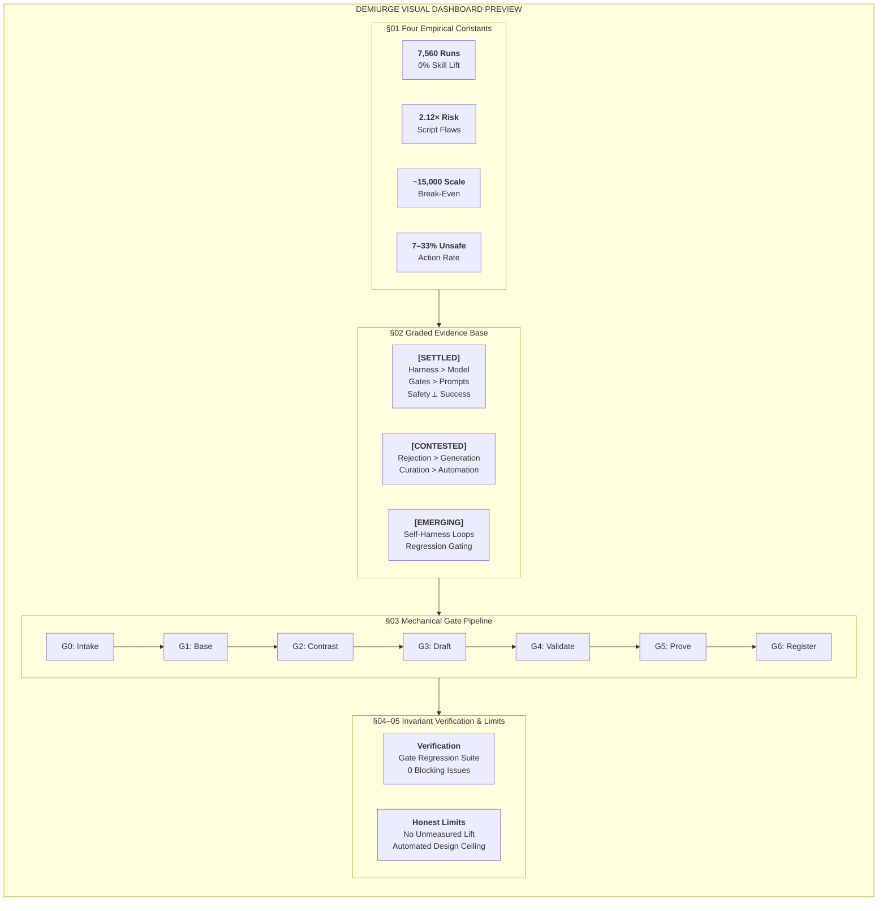

# Executive Research Brief

[Visual Dashboard](https://htmlpreview.github.io/?https://github.com/syst0m/demiurge/blob/main/skills/marcus/human-only/demiurge-brief.html)

The gist below is generated from the HTML brief. Run `python scripts/sync_brief_summary.py` to refresh it.

<!-- BEGIN DEMIURGE BRIEF GIST -->

## Four Empirical Constants That Shaped the Design

- **7,560**: runs in the only large controlled test of generated skills — which found no improvement over no skill at all
- **2.12×**: more likely to carry a vulnerability when a skill bundles executable scripts
- **~15,000**: deployed examples before automated design paid for itself — and only on two datasets of those tested
- **7–33%**: unsafe-action rate across fully scaffolded agents, uncorrelated with their task success

## Core Architectural Takeaways

- **Rejection Outweighs Generation:** Methods that achieve real performance lift (e.g., SkillCAT +49.7%) succeed by ruthlessly discarding candidates through contrastive test replay, not through speculative prompt generation.
- **The Harness Dominates the Model:** Model×harness pairing varies completion and efficiency dramatically across execution trajectories—enough to invert raw model leaderboard rankings.
- **Capability and Safety Are Orthogonal:** Unsafe-action rates (7–33%) do not track task success rates (39–64%). Scaling capability without mechanical write-gates amplifies vulnerability.
- **Four-Tier Trust Model (T1 to T4):** Each skill carries a provenance tier. T1 is user-written or factory-built and accepted at G5. T4 is third-party and unread, and is never installed.
<!-- END DEMIURGE BRIEF GIST -->
